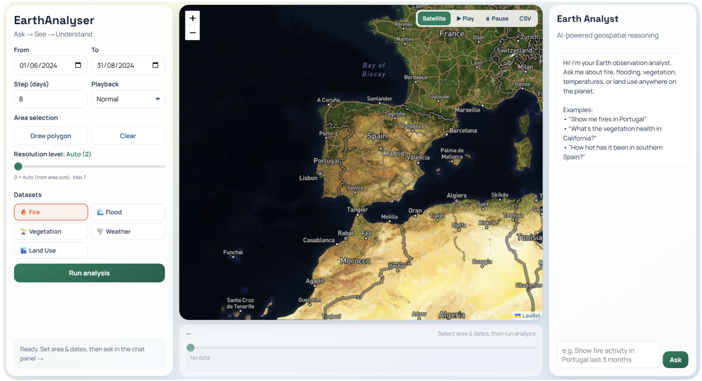
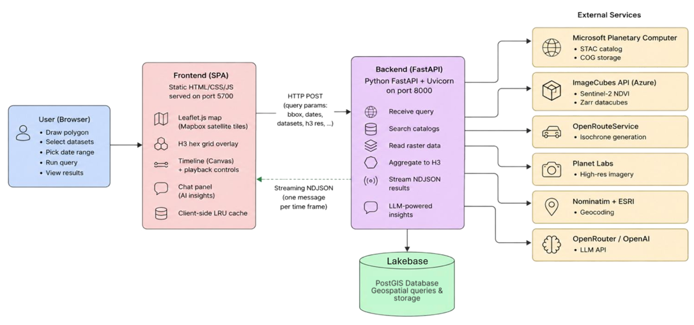

# EarthAnalyser

Interactive Leaflet map for exploring fire, surface water, vegetation, land surface temperature, and land cover from Microsoft Planetary Computer STAC. The backend aggregates raster values into H3 hexagons; the UI shows the results over time and can export CSV data. The chat panel uses an LLM when configured.

## Screenshot

## Architecture

The diagram shows the original development setup with a separate frontend on port 5700. In this repository, FastAPI serves the frontend on port 8000. ImageCubes, Planet, and the database are optional or externally provisioned integrations.

Run the [backend](../README.md#run-locally) from the repository root and open <http://127.0.0.1:8000/>. Map tiles work without a Mapbox token; raster requests need access to the public STAC service. AI features need `LLM_API_KEY`.
