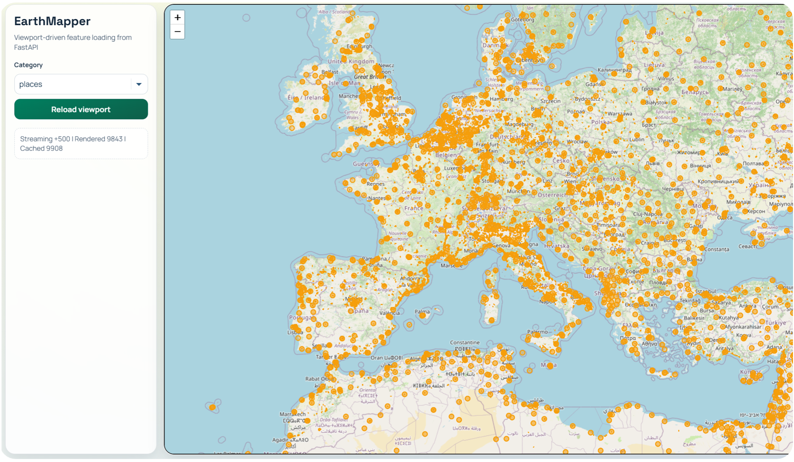
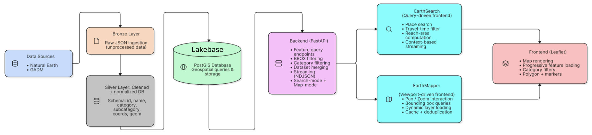

# EarthMapper

Viewport-driven Leaflet browser for Natural Earth and GADM vector features. It asks the FastAPI backend for features in the current map bounds and filters them by category.

## Screenshot

## Architecture

The bronze and silver data layers in the diagram describe upstream preparation of the PostGIS tables. That ingestion pipeline is not included in this repository.

Run the [backend](../README.md#run-locally) from the repository root and open <http://127.0.0.1:8000/mapper/>. The map loads without a Mapbox token, but feature queries require the prepared PostGIS tables described in the main README.
