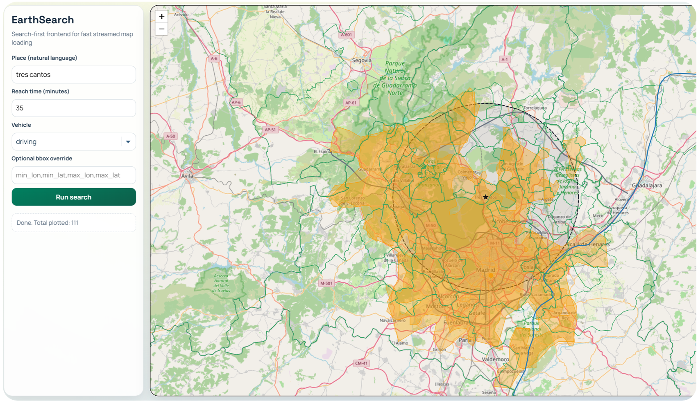

# EarthSearch

Map search for places, travel areas, and vector features. It combines geocoding, optional LLM prompt parsing, travel-time isochrones, and NDJSON feature streaming.

## Screenshot

## Architecture

The bronze and silver data layers in the diagram describe upstream preparation of the PostGIS tables. That ingestion pipeline is not included in this repository.

Run the [backend](../README.md#run-locally) from the repository root and open <http://127.0.0.1:8000/search/>. The feature queries need the prepared PostGIS tables described in the main README. Set `OSM_ORS_API_KEY` for travel-time isochrones and `LLM_API_KEY` for prompt parsing.
